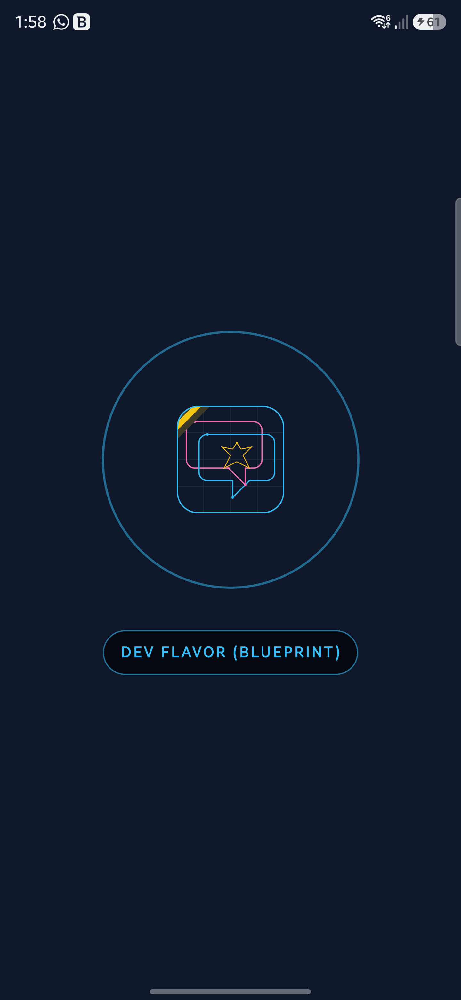
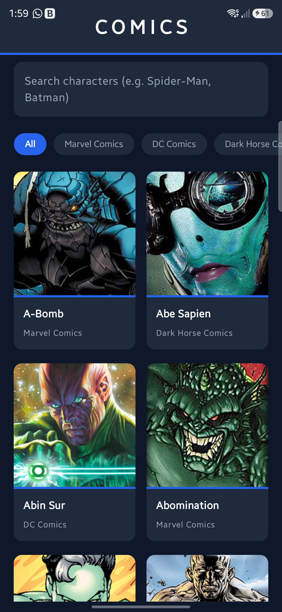
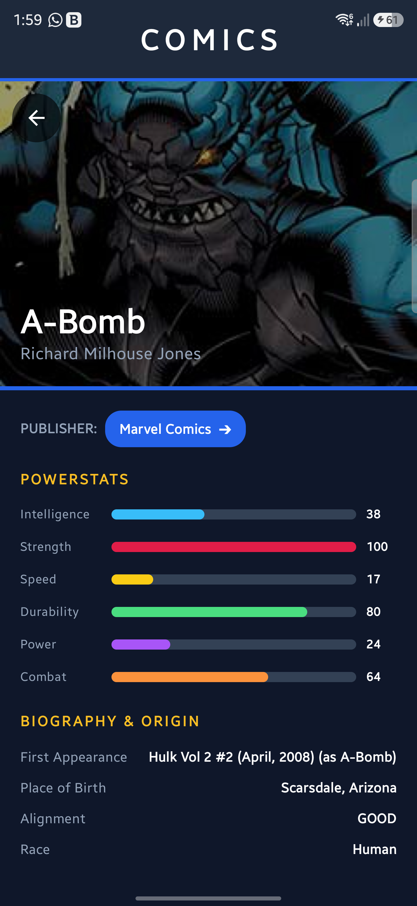

# Comics Explorer App 📚🦸‍♂️

[](https://github.com/SlashGil/marvel)
[](https://developer.android.com/)
[](https://kotlinlang.org/)

An Android Native application built with modern Android development practices, demonstrating **Clean Architecture**, **Offline-First Room Database**, **WorkManager A-Z Sync**, **MVVM**, **Jetpack Compose**, **Hilt**, **Retrofit2 + Kotlinx Serialization**, **Coil 3 Image Caching**, and automated **CI/CD with GitHub Actions & Firebase App Distribution**.

---

## 📲 Try the App!

> [!TIP]
> **Want to test the build?**
> 📩 **DM me on [LinkedIn](https://www.linkedin.com) or GitHub** if you want an invitation to try the app live via **Firebase App Distribution** or test the build APK!

---

## 📸 Screenshots

| Product-Flavor Splash | Character Grid & Search | Character Detail & Powerstats |
| :---: | :---: | :---: |
|  |  |  |

---

## 📱 Features

- **Multi-Vendor Comics Explorer**: Responsive grid displaying superheroes across all publishers (Marvel Comics, DC Comics, Dark Horse Comics, etc.).
- **Offline-First Room Database**: Persistent local storage using `data.local.contract` & `data.local.impl` architecture for instant offline access.
- **WorkManager A-Z Background Sync**: Pre-fetches comic superhero data sequentially for letters 'A' through 'Z' in the background with real-time foreground notifications and a completion alert when the database is ready.
- **High-Performance Image Caching**: Configured **Coil 3** with a 100MB disk/memory cache and CDN URL remapping for **10x faster image rendering**.
- **Product-Flavor Animated Splash Screen**: 3D Y-axis flip animation transitioning from **Dev Blueprint App Icon** to **Prod Comics App Icon**, surviving activity configuration changes (`rememberSaveable`).
- **Spoke Character Detail View**: Full character sheet featuring animated powerstats bar charts, origin, alignment, and team affiliations.
- **Real-Time Search**: Instant superhero lookup with debounced query processing.

---

## 🏗️ Architecture & Tech Stack

The application follows **Clean Architecture** principles separated into distinct layers:

```
├── domain          # Pure Kotlin: Models, Repository Interfaces, Use Cases
├── data            # DTOs, Mappers, Remote API, Local Room Database & DAOs
│   ├── local       # contract (ComicsLocalDataSource) & impl (ComicsLocalDataSourceImpl, Room DB, DAO, Entities)
│   └── remote      # contract (ComicsRemoteDataSource) & impl (Retrofit API, Interceptor)
├── presentation    # MVVM: ViewModels, UI State, Jetpack Compose Screens & Components
├── worker          # WorkManager (AlphabetSyncWorker with Foreground Notifications)
├── di              # Hilt Modules (NetworkModule, DatabaseModule, LocalDataSourceModule, RepositoryModule)
└── notification    # Firebase Messaging Service
```

### Key Libraries & Tools

| Component | Library / Tool |
| :--- | :--- |
| **Language** | Kotlin 2.1.10 |
| **UI** | Jetpack Compose + Material3 |
| **Architecture** | MVVM + Clean Architecture |
| **Local Database** | Room Database 2.6.1 (`data.local.contract` / `data.local.impl`) |
| **Background Sync** | WorkManager 2.10.0 + Foreground Service Notifications |
| **Dependency Injection** | Hilt (Dagger) |
| **Networking** | Retrofit2 + OkHttp3 + Kotlinx Serialization |
| **Image Loading** | Coil 3 Compose + 100MB Disk/Memory Cache |
| **Push Notifications** | Firebase Cloud Messaging (FCM) |
| **Testing** | MockK + Kotlinx Coroutines Test + JUnit4 |
| **CI/CD** | GitHub Actions + Firebase App Distribution |

---

## 🚀 Getting Started

### GitHub Repository

🔗 **Repository Link**: [https://github.com/SlashGil/marvel](https://github.com/SlashGil/marvel)

### Prerequisites

- **Android Studio** Ladybug or newer
- **JDK 17**
- **Android SDK** API 37 (minSdk 29, targetSdk 37)

### Build & Run Locally

1. **Clone the repository**:
   ```bash
   git clone https://github.com/SlashGil/marvel.git
   cd marvel
   ```

2. **Open in Android Studio**:
   - Open the project directory in Android Studio.
   - Sync Gradle project files (`./gradlew sync`).

3. **Run the App**:
   ```bash
   ./gradlew assembleDevDebug
   ```

---

## 🧪 Running Tests

Execute the unit test suite across Domain, Data, Local Room DataSource, and Presentation layers:

```bash
./gradlew testDevDebugUnitTest
```

All tests execute headlessly with MockK and Kotlinx Coroutines Test dispatchers.

---

## 🔄 CI/CD Pipeline (GitHub Actions)

The project includes a complete GitHub Actions pipeline defined in `.github/workflows/android_ci_cd.yml`:

1. **Build & Test**:
   - Compiles code with Java 17.
   - Runs unit tests (`./gradlew testDevDebugUnitTest`).
   - Builds Debug APK (`./gradlew assembleDevDebug`).
   - Saves APK artifacts (`comics-dev-debug-apk`).

2. **Firebase Distribution**:
   - Automatically deploys the debug APK to **Firebase App Distribution** on pushes to `main`/`master`.

---

## 📄 License

This project is open source and available under the [MIT License](LICENSE).
